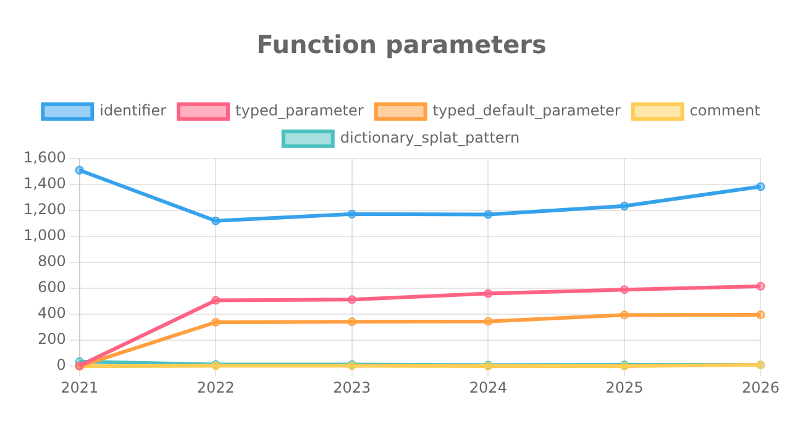

# Explorando evolução de código

Neste exercício, iremos explorar a evolução de código em sistemas reais.

Iremos utilizar a ferramenta [GitEvo](https://github.com/andrehora/gitevo).
Essa ferramenta analisa a evolução de código em repositórios Git nas linguagens Python, JavaScript, TypeScript e Java, e gera relatórios `HTML` como [este](https://andrehora.github.io/gitevo-examples/python/pandas.html).

Mais exemplos de relatórios podem ser podem ser encontrados em https://github.com/andrehora/gitevo-examples.

# Passo 1: Selecionar repositório a ser analisado

Selecione um repositório relevante na linguagem de sua preferência (Python, JavaScript, TypeScript ou Java).
Você pode encontrar projetos interessantes nos links abaixo:

- Python: https://github.com/topics/python?l=python
- JavaScript: https://github.com/topics/javascript?l=javascript
- TypeScript: https://github.com/topics/typescript?l=typescript
- Java: https://github.com/topics/java?l=java

# Passo 2: Instalar e rodar a ferramenta GitEvo

> [!NOTE]
> Antes de instalar a ferramenta, é recomendado criar e ativar um [ambiente virtual Python](https://packaging.python.org/en/latest/guides/installing-using-pip-and-virtual-environments/#create-and-use-virtual-environments).

Instale a ferramenta [GitEvo](https://github.com/andrehora/gitevo) com o comando:

```
$ pip install gitevo
```

Execute a ferramenta no repositório selecionado utilizando o comando abaixo (ajuste conforme a linguagem do repositório).
Substitua `<git_url>` pela URL do repositório que será analisado:

```shell
# Python
$ gitevo -r python <git_url>

# JavaScript
$ gitevo -r javascript <git_url>

# TypeScript
$ gitevo -r typescript <git_url>

# Java
$ gitevo -r java <git_url>
```

Por exemplo, para analisar o projeto Flask escrito em Python:

```
$ gitevo -r python https://github.com/pallets/flask
```

> [!NOTE]
> Essa etapa pode demorar alguns minutos pois o projeto será clonado e analisado localmente.

# Passo 3: Explorar o relatório de evolução de código

Após executar a ferramenta [GitEvo](https://github.com/andrehora/gitevo), é gerado um relatório `HTML` contendo diversos gráficos sobre a evolução do código.

Abra o relatório `HTML` e observe com atenção os gráficos.

# Passo 4: Explicar um gráfico de evolução de código

Selecione um dos gráficos de evolução e explique-o com suas palavras.
Por exemplo, você pode:

- Detalhar a evolução ao longo do tempo
- Detalhar se as curvas estão de acordo com boas práticas
- Explicar grandes alterações nas curvas
- Explorar a documentação do repositório em busca de explicações para grandes alterações
- etc.

Seja criativo!

# Instruções para o exercício

1. Crie um `fork` deste repositório (mais informações sobre forks [aqui](https://docs.github.com/pt/pull-requests/collaborating-with-pull-requests/working-with-forks/fork-a-repo)).
2. Adicione o relatório `HTML` no seu fork.
3. No Moodle, submeta apenas a URL do seu `fork`.

Responda às questões abaixo diretamente neste arquivo `README.md` do seu fork:

1. Repositório selecionado: https://github.com/pallets/click (relatório completo: [`report_click.html`](./report_click.html))
2. Gráfico selecionado:



3. Explicação:

O gráfico **`Function parameters`** apresenta a evolução anual (2021–2026) das categorias sintáticas de parâmetros nas definições de funções e métodos (`function_definition`) dos arquivos Python (`.py`) do projeto [**Click**](https://github.com/pallets/click), biblioteca amplamente adotada para criação de interfaces de linha de comando (CLI). A ferramenta GitEvo analisa o primeiro commit de cada ano por meio da árvore sintática concreta (*Concrete Syntax Tree* — CST, via Tree-sitter) e exibe as 5 categorias mais frequentes na versão mais recente:

| Categoria (nó Tree-sitter) | Significado na assinatura Python | 2021 (`4ae303e`) | 2022 (`ee5fdbf`) | 2023 (`e3467ff`) | 2024 (`15959d9`) | 2025 (`e2f2d84`) | 2026 (`5590ef4`) |
| :--- | :--- | :---: | :---: | :---: | :---: | :---: | :---: |
| `identifier` | Parâmetro simples sem anotação de tipo (ex.: `self`, `ctx`, `runner`) | 1.510 | 1.120 | 1.172 | 1.169 | 1.234 | 1.384 |
| `typed_parameter` | Parâmetro obrigatório com tipo (ex.: `name: str`, `**kwargs: t.Any`) | 3 | 507 | 513 | 560 | 590 | 616 |
| `typed_default_parameter` | Parâmetro opcional tipado com valor padrão (ex.: `err: bool = False`) | 0 | 339 | 342 | 345 | 395 | 396 |
| `dictionary_splat_pattern` | Desempacotamento `**kwargs` sem anotação de tipo | 35 | 13 | 13 | 8 | 10 | 10 |
| `comment` | Comentários internos em assinaturas multilinha (`# ...`) | 0 | 3 | 3 | 1 | 1 | 11 |

- **Grande inflexão entre 2021 e 2022 (lançamento do Click 8.0.0):**
  Na amostra do início de 2021 (`01/01/2021`, ainda na geração **Click 7.x**), a base de código praticamente não possuía *type hints*: havia **1.510** `identifier`, apenas **3** `typed_parameter` e **0** `typed_default_parameter` (enquanto os parâmetros com valor padrão sem tipo, `default_parameter`, somavam **322**). Já no início de 2022 (`13/01/2022`), observa-se uma mudança estrutural expressiva nas curvas: `typed_parameter` salta de **3 para 507**, `typed_default_parameter` salta de **0 para 339**, `identifier` recua abruptamente de **1.510 para 1.120** (-390 ocorrências) e `dictionary_splat_pattern` cai de **35 para 13** (pois assinaturas `**kwargs` tipadas como `**kwargs: t.Any` passam a ser representadas na CST como `typed_parameter`). Simultaneamente, os antigos `default_parameter` (sem tipo) despencaram de **322 para apenas 4**, saindo do *top 5* exibido pelo gráfico.
  Consultando a documentação de releases (`CHANGES.md`) e o histórico do Git, essa transformação é explicada pelo lançamento do **Click 8.0.0** (11 de maio de 2021), que **encerrou o suporte ao Python 2.7 e 3.5**, viabilizando o uso nativo de anotações de tipo (PEP 484). Nesse ciclo, os mantenedores configuraram checagem estática com `mypy` na integração contínua (PR `#1772`) e anotaram toda a biblioteca no PR `#1856` (commit `0103c95`, alterando 22 arquivos e introduzindo o marcador PEP 561 `src/click/py.typed`).

- **Evolução contínua de 2022 a 2026:**
  Após o salto de 2022, tanto `typed_parameter` (**507 → 616**, +21,5%) quanto `typed_default_parameter` (**339 → 396**, +16,8%) crescem de forma consistente e monotônica. Conforme registrado no `CHANGES.md`, esse crescimento reflete a maturação contínua das assinaturas tipadas — incluindo a adoção de `from __future__ import annotations` (PR `#2270`), a remoção de suporte ao Python 3.7–3.9 na versão **8.2.0** (maio de 2025, habilitando uniões modernas `X | Y` da PEP 604) e o uso de tipos genéricos em `Choice` e `ParamType`. Até mesmo a subida pontual de `comment` de **1 (2025) para 11 (2026)** tem causa documentada: durante o retrabalho de `flag_value` e `default` no **Click 8.3.0** (setembro de 2025, PR `#3030`), foi adicionado um bloco explicativo de 10 linhas de comentário (`# XXX ...`) diretamente dentro da lista de parâmetros de `Parameter.__init__` (`src/click/core.py`), além de uma diretiva `# type: ignore` em `src/click/types.py`.

- **Conformidade com boas práticas (e por que `identifier` permanece acima de 1.100):**
  À primeira vista, o fato de `identifier` permanecer no topo do gráfico e crescer gradualmente de **1.120 (2022) para 1.384 (2026)** poderia sugerir que parte do código deixou de ser tipada. Porém, inspecionando a origem desses nós nos 62 arquivos `.py` do commit de 2026 (`5590ef4`), constata-se aderência exemplar às boas práticas do ecossistema Python:
  1. **Código de produção (`src/click/`):** contabiliza **578** `typed_parameter`, **392** `typed_default_parameter`, **0** `default_parameter` sem tipo e **352** `identifier` — sendo que **100% desses 352 `identifier` correspondem exclusivamente a `self` e `cls`** em métodos de instância e de classe (**0** parâmetros comuns sem tipo em toda a biblioteca). Omitir anotações redundantes em `self`/`cls` segue diretamente a convenção idiomática da PEP 8 / PEP 484.
  2. **Suíte de testes (`tests/`, 892 `identifier`) e exemplos (`examples/`, 140 `identifier`):** concentram os **1.032** `identifier` restantes, formados majoritariamente por *fixtures* injetadas pelo `pytest` (`runner`, `monkeypatch`, `tmp_path`) em funções `test_*` e *callbacks* de CLI ilustrativos, onde é prática padrão privilegiar concisão nos testes. Portanto, o crescimento gradual de `identifier` entre 2022 e 2026 acompanha a **expansão contínua dos testes automatizados** junto às novas funcionalidades.
  3. **Prevenção de regressões via CI:** a estabilidade quase nula de parâmetros opcionais sem tipo ao longo de cinco anos comprova que a verificação estática automatizada (`mypy`/`pyright`) impediu regressões de qualidade, evidenciando uma evolução de software disciplinada e sustentável.


